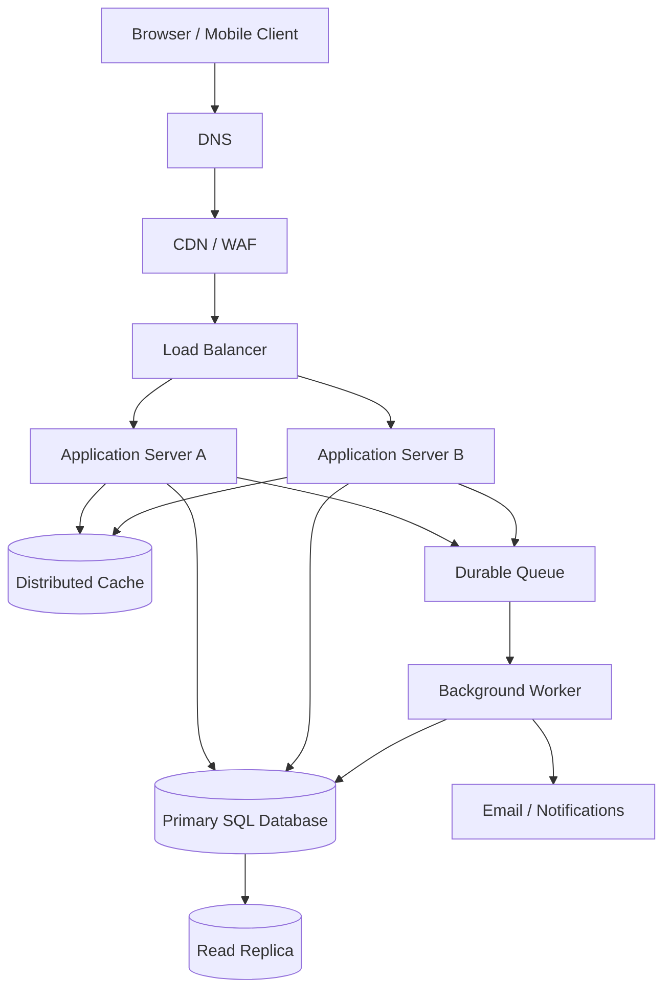

# QuickNotes Architecture and Scale Plan

## Functional requirements

1. Users can register, log in, and securely access their own notes.
2. Users can create, list, view, edit, and delete notes.
3. Users can create tags and attach multiple tags to a note.
4. Users can search and filter notes and receive paginated results.
5. The API returns consistent validation and error responses.
6. Users can use the service from a responsive browser client.

## Non-functional requirements

- **Availability:** target 99.9% monthly availability for the API.
- **Performance:** target p95 under 300 ms for cached list reads and under 500 ms for ordinary database-backed reads, subject to load testing.
- **Security:** HTTPS, secure password hashing, token validation, least privilege, input validation, and per-user authorization.
- **Scalability:** add stateless application instances horizontally as traffic grows.
- **Durability:** automated database backups, point-in-time recovery, and tested restore procedures.
- **Observability:** central logs, metrics, traces, request IDs, alerts, and health checks.
- **Maintainability:** versioned APIs, automated tests, CI/CD, and database migrations.

## Load estimates for 1 million users

These are planning assumptions, not measured traffic. Assume 1,000,000 registered users, 20% daily active users (200,000), each active user makes 100 reads and 5 writes per day, and average note storage is 2 KB including text and basic row overhead. Assume each active user creates 1 note per day and average note data remains 2 KB.

| Estimate | Calculation | Average |
|---|---|---:|
| Reads/day | 200,000 × 100 | 20,000,000 |
| Reads/second | 20,000,000 ÷ 86,400 | ~231 reads/s |
| Writes/day | 200,000 × 5 | 1,000,000 writes/day |
| Writes/second | 1,000,000 ÷ 86,400 | ~12 writes/s |
| New note storage/year | 200,000 notes/day × 2 KB × 365 | ~146 GB/year |

Storage estimate covers newly created note records only. It excludes indexes, replicas, backups, tags, user rows, logs, and growth in existing notes. With 3× peak-to-average traffic, plan initially for roughly 700 reads/s and 36 writes/s, then load-test and adjust. Real peaks and usage patterns may differ substantially.

## Architecture diagram

## Components and the problems they solve

- **Client:** provides the interface and makes HTTPS API calls; it keeps the experience accessible across devices.
- **DNS:** maps the public API hostname to the service entry point and supports controlled routing changes.
- **CDN/WAF:** serves cacheable static assets near users and filters common malicious traffic; private note data must not be publicly cached.
- **Load balancer:** distributes requests across healthy application instances and stops sending traffic to unhealthy instances.
- **Application servers A and B:** run the stateless API; multiple instances increase capacity and allow rolling deployments.
- **Distributed cache:** reduces repeated database reads for safe-to-cache data; use short TTLs and invalidate or version entries after writes.
- **Primary SQL database:** provides transactional writes and the authoritative data store.
- **Read replica:** serves eligible read-only queries to reduce primary database load; replication lag means very recent writes may not immediately appear there.
- **Durable queue:** buffers asynchronous jobs and decouples user requests from slow or unreliable downstream tasks.
- **Background worker:** processes notifications, cleanup, exports, and other retryable tasks outside the request path.
- **Email/notification provider:** delivers messages without making the main API wait for delivery.

## GET /notes request flow

1. The client sends `GET /v1/notes?page=1&limit=20` over HTTPS with an access token.
2. DNS resolves the API hostname; the CDN/WAF applies edge protections and forwards the dynamic request.
3. The load balancer selects a healthy application server.
4. The server validates the token, derives the user ID, validates pagination, and checks authorization.
5. The application checks the cache only for a correctly user-scoped cache key. On a miss, it reads from the read replica when suitable, or the primary when read-after-write consistency is required.
6. The server returns a paginated JSON response and appropriate cache headers. Private note responses should normally use `Cache-Control: private` or `no-store` depending on product/security needs.
7. Metrics and logs record latency, status, and request ID without recording sensitive note content unnecessarily.

## POST /notes request flow

1. The client sends `POST /v1/notes` with a bearer token and JSON title/body.
2. The edge layer applies TLS, request-size limits, and rate limiting; the load balancer forwards the request to a healthy application server.
3. The application authenticates the user and validates the title, body size, and any tag IDs.
4. The server inserts the note and tag relationships in a database transaction on the primary database.
5. After commit, it invalidates or versions relevant user-scoped cache entries.
6. If a notification or audit job is needed, the server publishes it to the durable queue (ideally through a transactional outbox so committed changes are not lost if publishing fails).
7. The API returns `201 Created`, a representation of the note, and a `Location` header. The worker processes asynchronous tasks and retries transient failures.

## Trade-offs and failure handling

### 1. SQL consistency versus read scalability
A primary database plus read replica keeps writes strongly consistent while offloading reads, but replication lag can briefly show stale lists. Route immediate read-after-write requests to the primary or use a consistency-aware strategy. Monitor lag and stop routing reads to an unhealthy replica.

### 2. Cache speed versus invalidation complexity
Caching reduces database load and latency, but stale or incorrectly shared cache entries can expose outdated or private data. Use per-user keys, short TTLs, write invalidation/versioning, and never cache private responses in a public CDN.

### 3. Synchronous work versus queue-based work
A queue improves request latency and absorbs bursts, but adds operational complexity and eventual consistency. Use durable messages, retries with backoff, dead-letter handling, idempotent workers, and queue-depth alerts.

### Avoiding single points of failure

- Run at least two application servers across separate availability zones behind a health-checking load balancer.
- Deploy redundant DNS and edge services through managed providers.
- Use a highly available database configuration with automated failover, backups, point-in-time recovery, and tested restore drills; a replica alone is not a backup.
- Run redundant queue brokers or use a managed durable queue, and make workers restartable and idempotent.
- Monitor cache health and degrade gracefully to the database when safe; rate-limit fallback traffic to prevent overload.
- Spread instances across failure domains, automate deployment/rollback, and regularly test failover rather than assuming it works.
